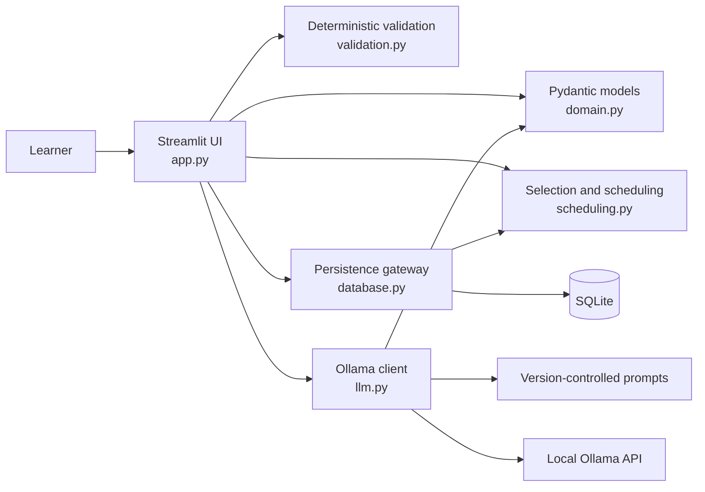
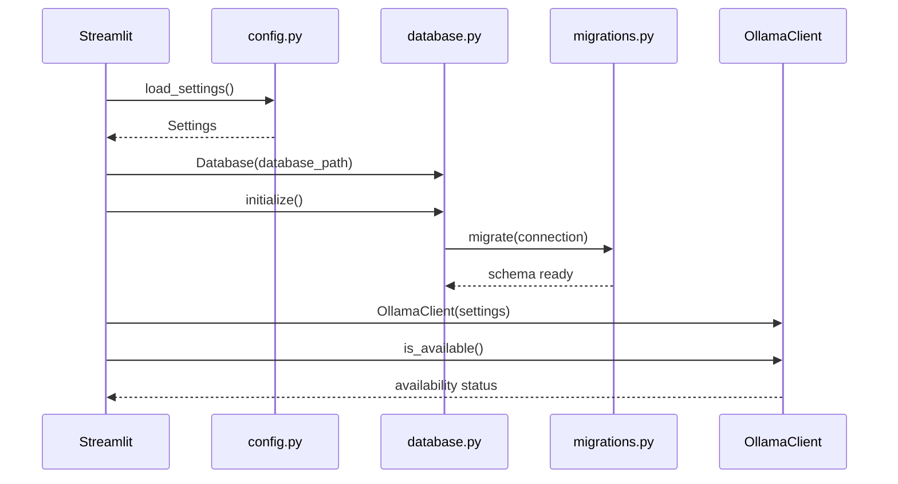
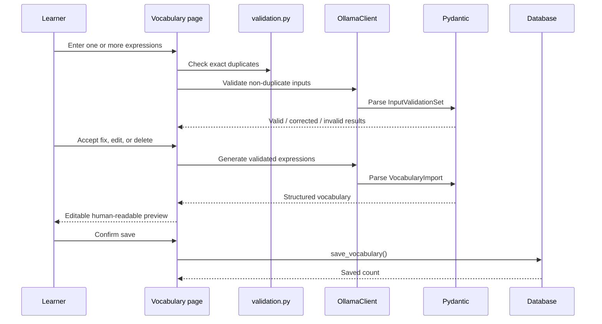
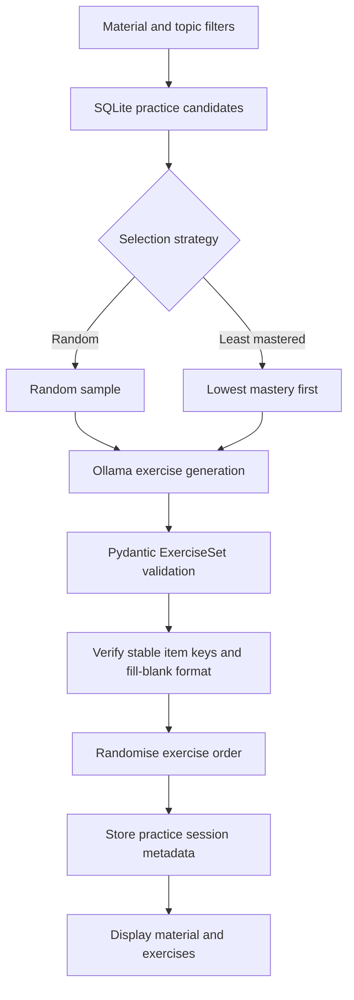
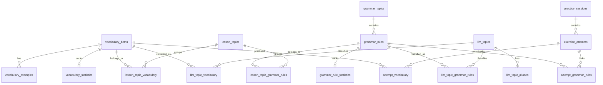

# English Learning Application Architecture

## 1. Purpose

This document describes the current architecture of the local English learning
application. It covers the implemented system rather than proposed or
unfinished functionality.

The application supports:

- vocabulary and grammar input validation
- structured content generation
- learner review and editing before persistence
- manual and LLM-proposed topic organisation
- vocabulary, grammar, and mixed practice
- answer evaluation and attempt history
- mastery statistics and review scheduling

The application is local-first. Learner content, generated learning material,
practice history, and progress statistics remain in a local SQLite database.
Ollama is the only model integration and normally runs on the same computer.

## 2. Architectural style

The project is a modular monolith implemented as one Python package and one
Streamlit application.



The intended dependency direction is:

```text
UI -> workflow/domain logic -> database
                          \-> LLM client
                          \-> scheduling and validation
```

`app.py` still contains most workflow orchestration. As workflows become more
complex, orchestration should move into service modules without making
database, domain, scheduling, validation, or LLM modules depend on Streamlit.

## 3. Core architectural invariants

The following rules define the system's trust and responsibility boundaries:

1. **SQLite is the source of truth.** Session state and model output are
   temporary until explicitly saved.
2. **Ollama never writes to SQLite.** The UI/application workflow decides when
   validated content may be persisted.
3. **All structured model output is untrusted.** It must pass a Pydantic model
   before it is used.
4. **Generated learning content is previewed before saving.** The learner can
   edit vocabulary and grammar in human-readable forms.
5. **Deterministic work stays in Python.** Duplicate matching, random or
   least-mastered selection, multiple-choice checking, mastery updates, and
   review dates do not depend on the LLM.
6. **Multi-record persistence is transactional.** Database context managers
   commit complete operations or roll them back on failure.
7. **Learner data remains local by default.** There are no cloud databases,
   hosted model APIs, vector databases, or agent frameworks.

## 4. Package structure

```text
src/english_learning/
|-- app.py
|-- config.py
|-- database.py
|-- domain.py
|-- llm.py
|-- migrations.py
|-- scheduling.py
|-- validation.py
`-- prompts/
    |-- vocabulary_validate.md
    |-- vocabulary_extract.md
    |-- grammar_validate.md
    |-- grammar_extract_many.md
    |-- exercise_generate.md
    |-- answer_evaluate.md
    `-- answers_evaluate.md
```

### `app.py`

Owns the Streamlit presentation layer and current workflow orchestration.

Responsibilities include:

- application startup and dependency construction
- Streamlit session state
- dynamic vocabulary and grammar input fields
- correction, deletion, and resubmission controls
- editable previews of generated content
- page navigation
- topic-management interactions
- practice controls and answer collection
- displaying validation, generation, persistence, and evaluation errors
- terminal-level application logging

The current pages are:

| Page | Responsibility |
|---|---|
| Vocabulary | Validate, generate, preview, edit, and save vocabulary |
| Grammar | Validate, generate, preview, edit, and save grammar topics |
| Learn | Display saved material grouped by lesson or approved LLM topic |
| Practice | Select material, generate exercises, submit all answers, and show per-exercise results |
| Topics | Manage lesson topics and resolve LLM topic proposals |
| Library | Browse persisted vocabulary and grammar |
| Progress | Display counts, mastery, due items, and weak material |

### `domain.py`

Defines Pydantic models for domain data and every structured LLM boundary.
Unknown fields are rejected by default.

Main model groups:

- `VocabularyItem`, `VocabularyImport`, and `VocabularyExample`
- `GrammarTopic`, `GrammarImport`, `GrammarRule`, and `IncorrectExample`
- `TopicAssignment`, `ApprovedTopicAssignment`, and
  `ProposedTopicAssignment`
- `InputValidation` and `InputValidationSet`
- `Exercise` and `ExerciseSet`
- `AnswerEvaluation`, `IndexedAnswerEvaluation`, and
  `AnswerEvaluationSet`

Topic confidence accepts either the canonical `0..1` range or model-produced
percentage values such as `80` and `"80%"`, which are normalised to `0.8`.
Values outside the supported range remain invalid.

### `llm.py`

Owns all communication with Ollama through its local HTTP API.

Public operations:

- validate vocabulary inputs
- validate grammar inputs
- generate vocabulary records
- generate one or many indexed grammar topics
- generate exercises
- evaluate one or many answers
- check whether Ollama is available

The shared structured-chat implementation:

1. loads a focused prompt
2. inserts learner level and English variant
3. puts learner content in the user message
4. sends the Pydantic JSON schema through Ollama's `format` field
5. disables model thinking and applies a task-sized output-token budget
6. validates the returned message content with Pydantic
7. raises `OllamaError` for transport, HTTP, or validation failures

Requests, durations, token counts, and generation throughput are logged to the
Streamlit terminal. Invalid structured responses log the Pydantic or parsing
reason without logging the original learner request.

### `database.py`

Is the only persistence gateway.

Responsibilities include:

- opening SQLite connections
- enabling foreign keys
- initialising the base schema and migrations
- vocabulary and grammar persistence
- transactional multi-topic and multi-attempt writes
- lesson-topic membership
- LLM-topic assignment and proposal resolution
- learning-content queries
- practice-candidate queries
- practice-session and attempt history
- mastery, streak, and review-date updates
- progress summaries

Database methods do not depend on Streamlit or Ollama.

### `migrations.py`

Owns versioned schema upgrades and seeded topic-taxonomy data.

The migration process:

1. creates `schema_migrations` when necessary
2. records the base schema as version 1 for legacy databases
3. applies later migrations only once
4. seeds approved vocabulary and grammar topics

Existing tables must not be changed outside a migration when a deployed
database may already contain learner data.

### `scheduling.py`

Contains deterministic practice and review logic:

- mastery-score updates
- next-review-date calculation
- random or least-mastered material selection
- random exercise ordering

The current mastery update uses 80% of the previous mastery and 20% of the
latest answer score after the first attempt.

### `validation.py`

Contains deterministic input normalisation, duplicate detection, and
validation-cache key generation.

Exact duplicates are detected using case-insensitive, whitespace-normalised
text. The LLM validation step can additionally identify semantically duplicate
entries against a supplied saved-content catalogue. Successful validations are
cached in Streamlit session state; keys include the model, validation task,
normalised input, prompt version, and current saved-entry catalogue.

### `prompts/`

Contains one runtime prompt per model task.

| Prompt | Structured response |
|---|---|
| `vocabulary_validate.md` | `InputValidationSet` |
| `vocabulary_extract.md` | `VocabularyImport` |
| `grammar_validate.md` | `InputValidationSet` |
| `grammar_extract_many.md` | `GrammarImport` |
| `exercise_generate.md` | `ExerciseSet` |
| `answer_evaluate.md` | `AnswerEvaluation` |
| `answers_evaluate.md` | `AnswerEvaluationSet` |

Validation, extraction, and answer evaluation use temperature `0`. Exercise
generation uses a low non-zero temperature for controlled variation.

## 5. Configuration and startup

`config.py` reads environment variables into an immutable `Settings`
dataclass.

| Setting | Environment variable | Default |
|---|---|---|
| Ollama model | `ENGLISH_LEARNING_MODEL` | `qwen3:8b` |
| Ollama URL | `ENGLISH_LEARNING_OLLAMA_URL` | `http://localhost:11434` |
| Ollama model residency | `OLLAMA_KEEP_ALIVE` | `30m` |
| SQLite path | `ENGLISH_LEARNING_DB` | `data/english_learning.sqlite3` |
| Learner level | `ENGLISH_LEARNING_LEVEL` | `B2` |
| English variant | `ENGLISH_LEARNING_VARIANT` | `British` |

Application startup follows this sequence:



The application remains usable for saved content, topics, and progress when
Ollama is unavailable. Generation, model-based validation, and semantic answer
evaluation require Ollama.

## 6. Main workflows

### 6.1 Vocabulary ingestion



Vocabulary is upserted by `normalized_expression`. Re-importing an existing
normalised expression updates its content rather than creating another row.

### 6.2 Grammar ingestion

Each grammar input field is validated separately. Valid notes are sent together
in one Ollama request and returned as indexed `GrammarTopic` objects. The client
rejects missing or duplicate indexes, restores the original input order, and
the UI displays each topic in a separate editable form before saving all topics
in one transaction through `save_grammar_topics`.

Grammar topics currently create new records. Semantic duplicate validation
reduces accidental duplication, but there is no database uniqueness constraint
or topic-versioning mechanism.

### 6.3 Topic organisation

The system has two topic systems:

1. **Lesson topics** are manually created learner groupings. They can contain
   vocabulary items and individual grammar rules.
2. **LLM topics** form a controlled taxonomy. Seed topics begin as approved;
   new model-proposed topics begin as pending.

Pending LLM topics can be:

- approved, optionally with a renamed label
- merged into an approved topic
- rejected

Assignments retain confidence, rationale, and whether they came from the model
or learner.

### 6.4 Practice generation



Every exercise refers to saved material through stable keys:

```text
vocabulary:<database-id>
grammar_rule:<database-id>
```

The Ollama client rejects exercises that reference material not supplied to
the generation request.

### 6.5 Answer submission

The learner completes all exercises and submits the set once.

- Multiple-choice answers are checked deterministically in Python.
- Free-text answers are sent together in one Ollama request.
- The model must return exactly one indexed evaluation per submitted answer.
- Results remain associated with their exercise index.
- All attempts and statistics are saved transactionally.
- Correctness, explanation, correction, and accepted answers are displayed
  under each exercise.

### 6.6 Progress updates

Saving an attempt:

1. inserts an `exercise_attempts` record
2. links it to vocabulary and/or grammar rules
3. increments correct, partial, or incorrect counters
4. updates total score and mastery
5. updates current and longest streaks
6. records last-practised and next-review timestamps

## 7. Persistence model

The database separates queryable entities and relationships while using JSON
columns for small embedded lists.



### Main tables

| Area | Tables |
|---|---|
| Vocabulary | `vocabulary_items`, `vocabulary_examples` |
| Grammar | `grammar_topics`, `grammar_rules` |
| Manual topics | `lesson_topics`, `lesson_topic_vocabulary`, `lesson_topic_grammar_rules` |
| LLM taxonomy | `llm_topics`, `llm_topic_aliases`, `llm_topic_vocabulary`, `llm_topic_grammar_rules` |
| Practice | `practice_sessions`, `exercise_attempts`, `attempt_vocabulary`, `attempt_grammar_rules` |
| Statistics | `vocabulary_statistics`, `grammar_rule_statistics` |
| Schema management | `schema_migrations` |

JSON columns are used for bounded lists such as tags, collocations, verbs,
examples embedded in grammar rules, exceptions, notes, and practice-selection
metadata. Entities requiring joins, filtering, or independent lifecycle
management use relational tables.

## 8. State ownership

| State | Owner | Lifetime |
|---|---|---|
| Input fields and editable previews | Streamlit session state | Browser session |
| Validated LLM response objects | Streamlit session state until saved | Browser session |
| Successful input-validation cache | Streamlit session state | Browser session |
| Learning material | SQLite | Durable |
| Topic assignments | SQLite | Durable |
| Practice sessions and attempts | SQLite | Durable |
| Mastery and review dates | SQLite | Durable |
| Prompts | Source control | Application release |
| Local model files | Ollama | External local runtime |

Streamlit session state must not be treated as persistence. A browser refresh or
new session may discard unsaved work.

## 9. Error handling and observability

Expected recoverable errors are shown as actionable Streamlit messages.
Examples include:

- Ollama unavailable
- malformed or incomplete model output
- invalid edited preview data
- duplicate lesson-topic names
- foreign-key or integrity failures

Terminal logs include:

- application session startup
- page navigation
- content-save events
- practice-save events
- Ollama task and model
- request duration
- prompt and generated token counts
- model load, prompt evaluation, and generation durations
- generated tokens per second
- HTTP or transport failures
- structured-output parsing and Pydantic validation reasons

Learner request text is intentionally not written to application logs.

## 10. Testing architecture

The test suite uses `pytest` and does not require a running Ollama model.

| Test file | Main coverage |
|---|---|
| `test_database.py` | Vocabulary, grammar, and transactional persistence |
| `test_topics_and_statistics.py` | Topics, migrations, attempts, mastery, and progress |
| `test_scheduling.py` | Selection, ordering, mastery, and review dates |
| `test_exercises.py` | Exercise-domain invariants |
| `test_llm_logging.py` | Mocked structured Ollama boundary and logging |
| `test_validation.py` | Deterministic input normalisation and duplicates |

Persistence tests use temporary SQLite databases. LLM tests replace the HTTP
boundary with deterministic responses. The normal test suite must never call a
real model.

## 11. Extension guidelines

### Add a new LLM workflow

1. Define a strict Pydantic response model in `domain.py`.
2. Add one focused prompt under `prompts/`.
3. Add a typed method to `OllamaClient`.
4. Validate exact identifiers and counts after Pydantic parsing when the model
   references application-owned records.
5. Keep persistence decisions outside `llm.py`.
6. Add mocked success, malformed-output, and incomplete-output tests.

### Add persistent data

1. Add a new migration rather than editing deployed schema assumptions.
2. Use explicit foreign keys.
3. Preserve existing learner content and history.
4. Keep multi-record writes transactional.
5. Add temporary-database tests for migration and persistence behaviour.

### Add deterministic practice behaviour

Place selection, scoring, checking, and review-date logic in Python modules
such as `scheduling.py`, not in prompts.

### Split application services

The next architectural decomposition point is workflow orchestration currently
inside `app.py`. Candidate services include:

- vocabulary ingestion
- grammar ingestion
- practice-session creation
- practice-submission evaluation
- topic proposal resolution

These services should accept domain objects and explicit dependencies rather
than import Streamlit.

## 12. Current limitations

The current architecture does not yet provide:

- full FSRS scheduling
- saved-content editing or deletion from the library
- automatic backups or export workflows
- prompt/model version metadata on persisted generated records
- grammar topic versioning
- deterministic checking for every free-text fill-in answer
- a dedicated service layer for all application workflows

These are known extension areas, not currently available features.
